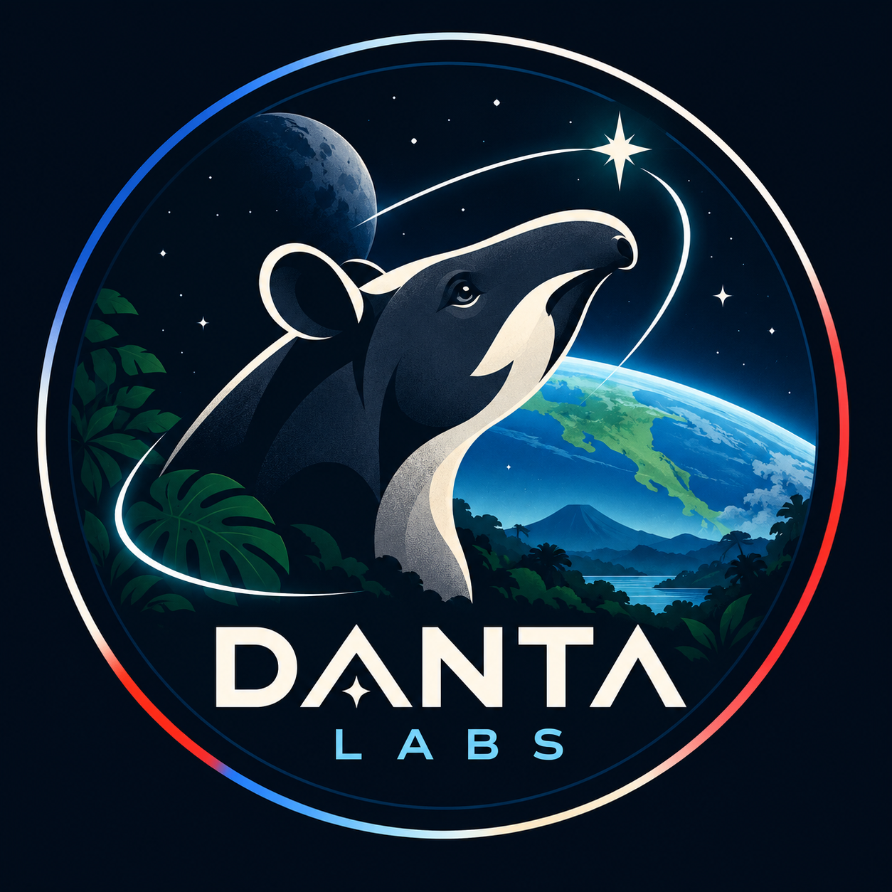

# 🚀 Danta Labs

<p align="center">
  
</p>

**NASA Space Apps Challenge 2026 | Costa Rica 🇨🇷**

### About the Project

Danta Labs is a six-member team from Costa Rica taking part in the [NASA Space Apps Challenge 2026](https://www.spaceappschallenge.org/). Our name comes from the danta (tapir), an animal native to Costa Rica, and reflects our connection to nature, science, space exploration, and creativity.

Our working project title is **Abandoned but Not Forgotten**. The project is being developed during the hackathon as a tabletop experience that connects physical play with stories about space exploration equipment.

### The Challenge

We are participating in [Abandoned but Not Forgotten: Storytelling about NASA's Discarded Equipment on the Moon and Mars](https://www.spaceappschallenge.org/2026/challenges/abandoned-but-not-forgotten-storytelling-about-nasas-discarded-equipment-on-the-moon-and-mars/). The challenge explores NASA equipment across the solar system, from the Moon and Mars to deep space, highlighting the scientific discoveries and lasting legacy of space exploration. This includes rovers, landers, scientific instruments, and spacecraft; some have completed their original missions, while others continue operating or traveling.

### Our Vision

We hope to connect young space enthusiasts with the history, scientific discoveries, and continuing legacy of this equipment. The focus is scientific storytelling—not simply objects left behind.

### Meet the Team

- **Celeste** — Team Leader
- Ericka
- Luis
- Ulises
- Pedro
- Sally

### Project Status

**In progress** — We are currently participating in the NASA Space Apps Challenge 2026. The web app is an early prototype; its features and experience are evolving during the hackathon.

### Getting Started

The web app is in the `web` directory and is built with React, TypeScript, Vite, and Tailwind CSS.

#### Prerequisites

- [Node.js](https://nodejs.org/) and npm
- Git

#### Install and run locally

From a terminal, clone the repository, install the locked dependencies, and start the development server:

```bash
git clone https://github.com/ericka-cespedes/danta-labs-space-apps-challenge-2026.git
cd danta-labs-space-apps-challenge-2026
cd web
npm ci
npm run dev
```

Open the local URL printed by Vite in your terminal.

#### Available commands

Run these commands from the `web` directory:

| Command | Description |
| --- | --- |
| `npm run dev` | Start the local development server |
| `npm run build` | Type-check and create a production build |
| `npm run preview` | Preview the production build locally |
| `npm run lint` | Run Oxlint |

### License

This project is intended to be licensed under the [Apache License 2.0](https://www.apache.org/licenses/LICENSE-2.0).

---

Made with curiosity, creativity, and a little pura vida 🇨🇷
